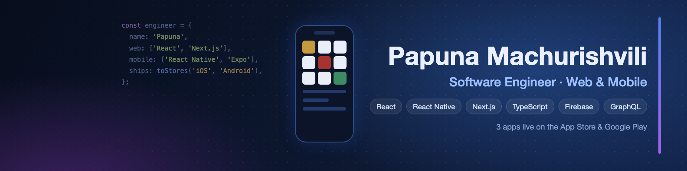

  

  
  
  

### Hi, I'm Papuna 👋

I build **web and mobile products end to end** with React, React Native, Next.js and TypeScript — from the first screen to the App Store and Google Play release.

For the past three years I've been a software engineer at **Bitnet**, a Georgian crypto exchange, working on trading and payment features across the web platform, the admin panel and the React Native mobile app. That work lives in private company repositories, so below are the apps I design, build and ship on my own.

### 📱 Apps I built and shipped

<table>
  <tr>
    <td align="center" width="33%">
       
      <b>History of Georgia</b> 
      Educational quiz game  
      <b>10K+ downloads</b> 
      ⭐ 4.8 Google Play · ⭐ 4.9 App Store  
      
       
      <a href="https://github.com/papunafshaveli/history-of-georgia">Source code</a>
    </td>
    <td align="center" width="33%">
       
      <b>Krossi</b> 
      Georgian crossword puzzle game  
      Stages, streaks, leaderboard 
      Cloud Functions push reminders  
      
      
    </td>
    <td align="center" width="33%">
       
      <b>Drosha</b> 
      Guess the Flag  
      Flag quiz in English and Georgian 
      Light and dark themes  
      
      
    </td>
  </tr>
</table>

All three: Expo · React Native · TypeScript · Firebase · EAS Build & Update

### 🛠 Tech

  
  
  
  
  
  
  
  
  
  
  
  

